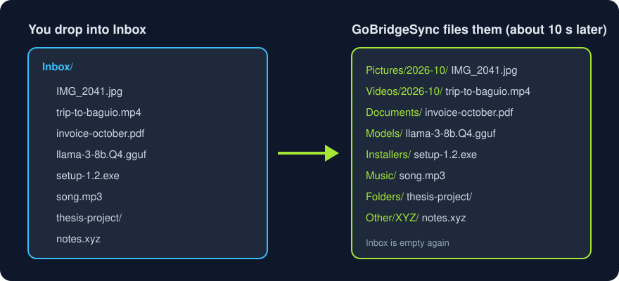

<p align="center"></p>

<p align="center">
  <a href="https://github.com/GodYtteria/gobridgesync-desktop/actions/workflows/ci.yml"></a>
  
  
</p>

| | |
|---|---|
|  | **Backup** your folders to Google Drive. Deleting a file on your computer keeps the Drive copy. |
|  | **Sync** `~/GoBridgeSync` across every computer signed in with the same Google account. |
|  | **Restore** folders, files, or older versions from Drive. Restores never overwrite your files. |
|  | **Inbox** sorts whatever you drop into it: photos, videos, documents, AI models, installers, and more, each into its own folder. |
|  | **Streaming folder** (Linux): your whole Drive as a folder, downloaded only when a file is opened. Edit, rename, and delete right there. |
|  | **Alerts** when a backup fails or Drive is almost full. |
|  | **Private.** Only touches files it created. Your sign-in stays in your system keyring. |
|  | **Free and open source.** |

<p align="center"></p>

## Install

### Windows

1. Press **Start**, type **PowerShell**, and open it.
2. Paste this line (right-click pastes) and press **Enter**:

   ```powershell
   irm https://raw.githubusercontent.com/GodYtteria/gobridgesync-desktop/main/install.ps1 | iex
   ```

3. Your browser opens GoBridgeSync. Click **Sign in with Google**.

### macOS and Linux

1. Open **Terminal** (macOS: **Cmd + Space**, type Terminal; Linux: **Ctrl + Alt + T**).
2. Paste this line and press **Enter**:

   ```sh
   curl -fsSL https://raw.githubusercontent.com/GodYtteria/gobridgesync-desktop/main/install.sh | sh
   ```

3. Your browser opens GoBridgeSync. Click **Sign in with Google**.

**Test versions:** to try the newest pre-release before everyone else, add `GBS_CHANNEL=staging` (macOS and Linux: `... | GBS_CHANNEL=staging sh`; Windows: run `$env:GBS_CHANNEL='staging'` first). A test version keeps updating to the newest pre-release or stable release.

GoBridgeSync starts with your computer and updates itself. Your files are in the **GoBridgeSync** folder in your home folder. To open it again, click the tray icon or go to <http://127.0.0.1:47811/>.

## Settings

Change these from the tray menu or the web interface.

| Setting | Default | Choices |
|---|---|---|
| Start at login | On | On, Off |
| Sync | Every 5 minutes | Instantly when files change, every 1, 5, 15, or 60 minutes, or Manual only |
| Don't back up | None | Folders you pick, or names like `*.tmp` or `node_modules` |
| Speed limit | Unlimited | 10 MB/s, 5 MB/s, 1 MB/s, 512 KB/s |
| Storage limit | 90% | All, 90%, 75%, 50% of your Drive storage |
| Sync across computers | On | On, Off |
| Install updates automatically | On | On, Off |
| Developer mode | Off | On, Off (shows the **Add developer folders** preset) |

**Data use:** without internet, GoBridgeSync uses almost no data and tries again later. Each check reads the list of your backed-up files, so if you have many files or a limited data plan, choose a longer interval or **Manual only**.

## Connect Google Drive

Use your own free Google OAuth client. One time, about 5 minutes. The app shows the same guide.

1. **[Create a project](https://console.cloud.google.com/projectcreate)** named `GoBridgeSync`. Keep the defaults and skip any billing offer.
   Seeing "Google Cloud access blocked"? Turn on [2-Step Verification](https://myaccount.google.com/signinoptions/two-step-verification), sign out, and sign in again.
2. **[Enable the Google Drive API](https://console.cloud.google.com/apis/library/drive.googleapis.com)**.
3. **[Set up the consent screen](https://console.cloud.google.com/auth/overview)**: app name `GoBridgeSync`, audience **External**. Then add your Google account under **[Audience → Test users](https://console.cloud.google.com/auth/audience)**. Keep it in **Testing**.
4. **[Create an OAuth client](https://console.cloud.google.com/auth/clients/create)**: type **Desktop app**, leave "AI-powered agent" off, and **Download JSON**.
5. In GoBridgeSync, choose the JSON and click **Sign in with Google**. At "Google hasn't verified this app", choose **Continue**.

## Inbox

Drop anything into **Inbox** and GoBridgeSync puts it in the right folder for you. Your other folders are never touched.

<p align="center"></p>

**How to use it**

1. Make sure **Sync across computers** is on (Settings). Inbox only works with sync.
2. Open the Inbox folder:
   - Windows: `C:\Users\<you>\GoBridgeSync\Inbox` (File Explorer)
   - macOS and Linux: `~/GoBridgeSync/Inbox` (Finder or Files)
   - Phone or another computer: open [drive.google.com](https://drive.google.com), go to **GoBridgeSync → Inbox**, and upload there.
3. Drag files or whole folders into it. You can drop many at once.
4. Wait about 10 seconds after the copy finishes. The files move into their folders (table below) and Inbox is empty again. The Activity list in the app shows each move.

**Where files go**

| Folder | Files |
|---|---|
| Pictures/`YYYY-MM`, Videos/`YYYY-MM` | photos and videos, by month |
| Music, Documents, Ebooks | audio; PDF, Office, text, Google Docs; e-books |
| Archives, Installers | zip, tar, 7z; exe, msi, dmg, rpm, deb, AppImage, iso |
| Models, Code, Design, 3D, Fonts | AI models; single source files; psd, fig, blend; stl, obj; ttf, otf |
| Folders | folders dropped into Inbox, moved whole |
| Other/`EXT` | anything else, one folder per file type |

Photos and videos go into a folder for the month the file was last modified (`2026-10`). Files still downloading or changed in the last 10 seconds wait. If a file with the same name is already there, the new one becomes `name (2).ext`; nothing is overwritten. Files already in Drive are moved on Drive, not uploaded again.

## Streaming folder (Linux)

Your whole Google Drive appears as a folder, `~/GoogleDrive-Stream`, without using disk space for it. A file is downloaded only when you open it, and only the parts you read. Recently used parts stay in a cache on disk.

**Turn it on**

1. Install FUSE once: Fedora `sudo dnf install fuse3`, Ubuntu/Debian `sudo apt install fuse3`.
2. In GoBridgeSync **Settings**, switch on **Streaming folder** and pick a **Streaming cache size** (how much disk the downloaded parts may use).
3. Open `~/GoogleDrive-Stream` in Files or a terminal.

**What you can do in it**

- Open, play, and seek in large files (videos, AI models) without downloading them first.
- Edit, save, rename, move, and delete files and folders. Changes upload a few seconds after you close the file. Deletes go to the Google Drive trash.
- Use normal tools: `git`, `rsync`, `cp -p`, editors, SQLite. File times are kept.

**Keep files on this computer** (pins): pinned files are downloaded fully and never removed from the cache, so they open instantly and work offline.

```sh
gobridgesync stream-pin Models/llama-3-8b.Q4.gguf    # a file
gobridgesync stream-pin Videos/2026-10               # a whole folder
gobridgesync stream-pins                             # list pins
gobridgesync stream-unpin Videos/2026-10
```

**Tips**

- Video editing: pin the project's media before you start, so the timeline plays smoothly; unpin it when you are done.
- Coding: pin the project folder you are working on, or keep active projects in the sync folder. The first open of each file that is not cached takes about a second.
- Speed follows your internet: about 1 second to start reading a part that is not cached, then as fast as your connection allows.
- Safety: deleting more than 5,000 files within 10 minutes through the streaming folder is refused (restore mistakes from the Google Drive trash).
- Windows and macOS: not available yet. Use the sync folder there.

## Coding in the sync folder

Turn on **Developer mode**, then use **Don't back up → Add developer folders** to skip `node_modules`, `.venv`, `build`, `dist`, `target`, and similar folders that `npm install` or a build recreates. `.env` and `.git` stay included. Work on a project from one computer at a time, and don't share project folders that contain `.env`.

## What syncs

| Item | Synced |
|---|---|
| Files and folders in My Drive | Yes, both ways |
| Google Docs, Sheets, Slides | As link files (`.gdoc`, `.gsheet`) that open in the browser |
| Shared with me | No |
| Shortcuts | No |
| Shared drives | No |
| Trash | No |
| Files Google blocks from download | Skipped, with a warning |

## Good to know

- Google allows 750 GB of uploads per user per day. Rate limits are retried automatically.
- If one pass would delete more than 5,000 files (or over half of your files), GoBridgeSync stops the deletes and asks you to **Allow** them. Everything else keeps syncing.
- Before it overwrites or deletes a Drive file, GoBridgeSync checks that the file has not changed on Drive since its last look.
- Two files with the same name in one Drive folder (for example from two computers) are kept: the extra one is renamed `name (conflict …)`.
- A folder link that points outside your backed-up folders shows a **Heads up** notice instead of being skipped silently.
- Removed files go to `~/.local/share/gobridgesync/trash/`, not straight to deletion. They stay there for 30 days.
- Google keeps older versions of a file for 30 days; restore them from **Restore → Versions**.
- Files in **Don't back up** are never deleted from Drive or other computers.
- Logs are in `~/.local/share/gobridgesync/gobridgesync.log` (tray → **Open log file**).
- Quitting from the tray asks for confirmation, so backups don't stop by accident.
- Updates are checked daily. Each release is signed, and GoBridgeSync refuses any update whose signature doesn't match the key built into the app.

## Uninstall

Quit GoBridgeSync from the tray, then run:

```sh
gobridgesync uninstall          # keep sign-in and settings
gobridgesync uninstall -purge   # also remove sign-in and settings
```

On Windows run `%LOCALAPPDATA%\GoBridgeSync\gobridgesync.exe uninstall`. Your files and your Google Drive are never touched.

## Build from source

```sh
git clone https://github.com/GodYtteria/gobridgesync-desktop.git
cd gobridgesync
go test ./...
./contrib/install-linux.sh
```

`./build.sh` builds release packages for every platform into `dist/`. Organizations with Google Workspace can build the internal edition, which syncs the whole Drive: `go build -ldflags "-X main.edition=internal"`.

## License

[Apache-2.0](LICENSE). The GoBridgeSync name and logo are not covered; see [NOTICE](NOTICE).

<p align="center">Developed by <b>GodYtteria</b> × <b>Bukluran ng Kalinga</b></p>
