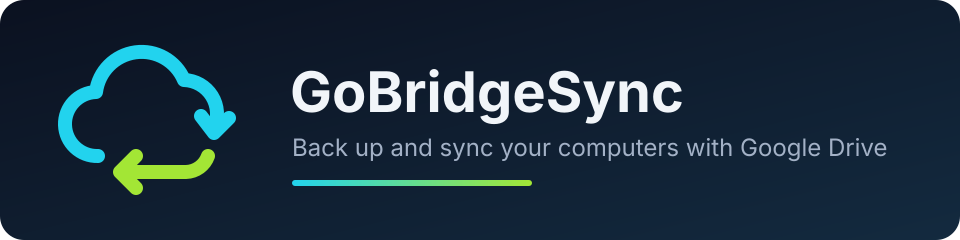
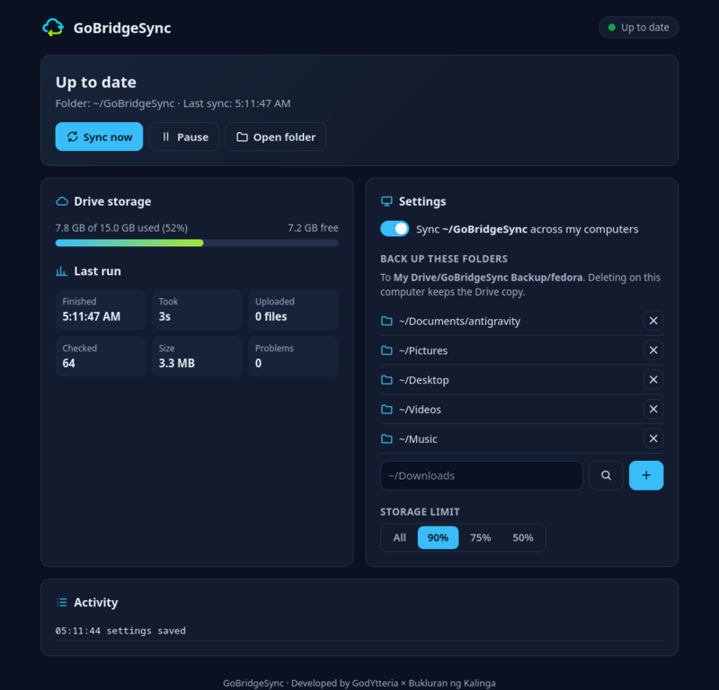

<p align="center"></p>

<p align="center">
  <a href="https://github.com/GodYtteria/gobridgesync-desktop/actions/workflows/ci.yml"></a>
  
  
</p>

| | |
|---|---|
|  | **Backup** your folders to Google Drive. Deleting a file on your computer keeps the Drive copy. |
|  | **Sync** `~/GoBridgeSync` across every computer signed in with the same Google account. |
|  | **Restore** folders, files, or older versions from Drive. Restores never overwrite your files. |
|  | **Alerts** when a backup fails or Drive is almost full. |
|  | **Private.** Only touches files it created. Your sign-in stays in your system keyring. |
|  | **Free and open source.** |

<p align="center"></p>

## Install

### Windows

1. Press **Start**, type **PowerShell**, and open it.
2. Paste this line (right-click pastes) and press **Enter**:

   ```powershell
   irm https://raw.githubusercontent.com/GodYtteria/gobridgesync-desktop/main/install.ps1 | iex
   ```

3. Your browser opens GoBridgeSync. Click **Sign in with Google**.

### macOS and Linux

1. Open **Terminal** (macOS: **Cmd + Space**, type Terminal; Linux: **Ctrl + Alt + T**).
2. Paste this line and press **Enter**:

   ```sh
   curl -fsSL https://raw.githubusercontent.com/GodYtteria/gobridgesync-desktop/main/install.sh | sh
   ```

3. Your browser opens GoBridgeSync. Click **Sign in with Google**.

GoBridgeSync starts with your computer and updates itself. Your files are in the **GoBridgeSync** folder in your home folder. To open it again, click the tray icon or go to <http://127.0.0.1:47811/>.

## Settings

Change these from the tray menu or the web interface.

| Setting | Default | Choices |
|---|---|---|
| Start at login | On | On, Off |
| Sync | Every 5 minutes | Instantly when files change, every 1, 5, 15, or 60 minutes, or Manual only |
| Don't back up | None | Folders you pick, or names like `*.tmp` or `node_modules` |
| Speed limit | Unlimited | 10 MB/s, 5 MB/s, 1 MB/s, 512 KB/s |
| Storage limit | 90% | All, 90%, 75%, 50% of your Drive storage |
| Sync across computers | On | On, Off |
| Install updates automatically | On | On, Off |

**Data use:** without internet, GoBridgeSync uses almost no data and tries again later. Each check reads the list of your backed-up files, so if you have many files or a limited data plan, choose a longer interval or **Manual only**.

## Connect Google Drive

Use your own free Google OAuth client. One time, about 5 minutes. The app shows the same guide.

1. **[Create a project](https://console.cloud.google.com/projectcreate)** named `GoBridgeSync`. Keep the defaults and skip any billing offer.
   Seeing "Google Cloud access blocked"? Turn on [2-Step Verification](https://myaccount.google.com/signinoptions/two-step-verification), sign out, and sign in again.
2. **[Enable the Google Drive API](https://console.cloud.google.com/apis/library/drive.googleapis.com)**.
3. **[Set up the consent screen](https://console.cloud.google.com/auth/overview)**: app name `GoBridgeSync`, audience **External**. Then add your Google account under **[Audience → Test users](https://console.cloud.google.com/auth/audience)**. Keep it in **Testing**.
4. **[Create an OAuth client](https://console.cloud.google.com/auth/clients/create)**: type **Desktop app**, leave "AI-powered agent" off, and **Download JSON**.
5. In GoBridgeSync, choose the JSON and click **Sign in with Google**. At "Google hasn't verified this app", choose **Continue**.

## Inbox

With sync across computers on, drop anything into `~/GoBridgeSync/Inbox`, on this computer, another computer, or drive.google.com. GoBridgeSync files it automatically; your other folders are never touched.

| Folder | Files |
|---|---|
| Pictures/`YYYY-MM`, Videos/`YYYY-MM` | photos and videos, by month |
| Music, Documents, Ebooks | audio; PDF, Office, text, Google Docs; e-books |
| Archives, Installers | zip, tar, 7z; exe, msi, dmg, rpm, deb, AppImage, iso |
| Models, Code, Design, 3D, Fonts | AI models; single source files; psd, fig, blend; stl, obj; ttf, otf |
| Folders | folders dropped into Inbox, moved whole |
| Other/`EXT` | anything else, one folder per file type |

Files still downloading or changed in the last 10 seconds wait. Name clashes become `name (2).ext`. Files already in Drive are moved on Drive, not uploaded again.

## Coding in the sync folder

Use **Don't back up → Add developer folders** to skip `node_modules`, `.venv`, `build`, `dist`, `target`, and similar folders that `npm install` or a build recreates. `.env` and `.git` stay included. Work on a project from one computer at a time, and don't share project folders that contain `.env`.

## What syncs

| Item | Synced |
|---|---|
| Files and folders in My Drive | Yes, both ways |
| Google Docs, Sheets, Slides | As link files (`.gdoc`, `.gsheet`) that open in the browser |
| Shared with me | No |
| Shortcuts | No |
| Shared drives | No |
| Trash | No |
| Files Google blocks from download | Skipped, with a warning |

## Good to know

- Files uploaded on drive.google.com into the sync folder are not seen by the app.
- Google allows 750 GB of uploads per user per day. Rate limits are retried automatically.
- Removed files go to `~/.local/share/gobridgesync/trash/`, not straight to deletion.
- Google keeps older versions of a file for 30 days; restore them from **Restore → Versions**.
- Files in **Don't back up** are never deleted from Drive or other computers.
- Logs are in `~/.local/share/gobridgesync/gobridgesync.log` (tray → **Open log file**).
- Quitting from the tray asks for confirmation, so backups don't stop by accident.
- Updates are checked daily. Each release is signed, and GoBridgeSync refuses any update whose signature doesn't match the key built into the app.

## Uninstall

Quit GoBridgeSync from the tray, then run:

```sh
gobridgesync uninstall          # keep sign-in and settings
gobridgesync uninstall -purge   # also remove sign-in and settings
```

On Windows run `%LOCALAPPDATA%\GoBridgeSync\gobridgesync.exe uninstall`. Your files and your Google Drive are never touched.

## Build from source

```sh
git clone https://github.com/GodYtteria/gobridgesync-desktop.git
cd gobridgesync
go test ./...
./contrib/install-linux.sh
```

`./build.sh` builds release packages for every platform into `dist/`. Organizations with Google Workspace can build the internal edition, which syncs the whole Drive: `go build -ldflags "-X main.edition=internal"`.

## License

[Apache-2.0](LICENSE). The GoBridgeSync name and logo are not covered; see [NOTICE](NOTICE).

<p align="center">Developed by <b>GodYtteria</b> × <b>Bukluran ng Kalinga</b></p>
